# Sklad pro účetní program POHODA

Ukázka aplikace pro správu skladu, která rozšiřuje účetní program POHODA. Navazuje na jeho skladové funkce a doplňuje evidenci variant zboží, skladových pozic a reportování stavu zásob.

Aplikace podporuje:

- příjemky a výdejky,
- evidenci a reportování variant zboží, například typu nebo barvy,
- příjem a výdej zboží na konkrétní skladové pozici,
- přehled vytížení prostoru skladu a aktuálního stavu zásob.

## 1. Nastavení programu POHODA

V programu POHODA otevřete účetní jednotku a zvolte **Databáze / POHODA mServer**. Vytvořte záznam s názvem, účetní jednotkou a portem `666`.

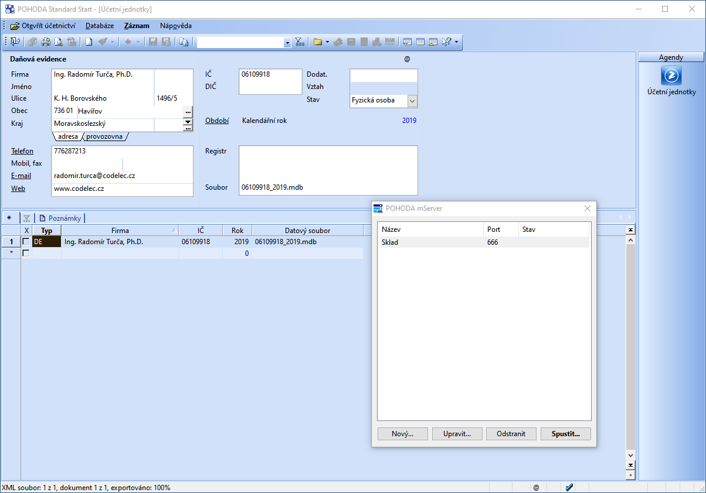
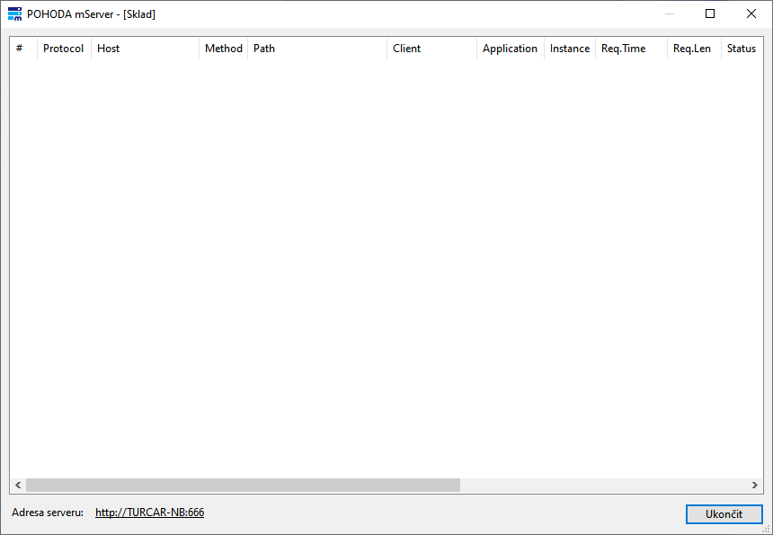

## 2. Nastavení programu Sklad

V adresáři aplikace upravte v souboru `warehouse.ini` IČO účetní jednotky nastavené v POHODA mServeru:

```ini
[Pohoda]
AccountingUnitIco="06109918"
```

Po spuštění aplikace se v okně **POHODA - Export/Import log** zobrazí načtené účetní jednotky. V okně POHODA mServeru se objeví záznam příchozího požadavku HTTP POST.

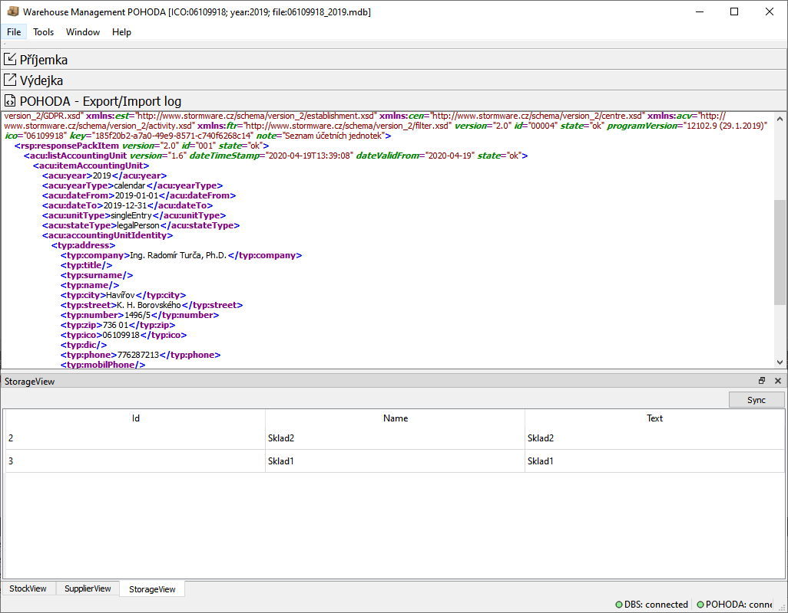
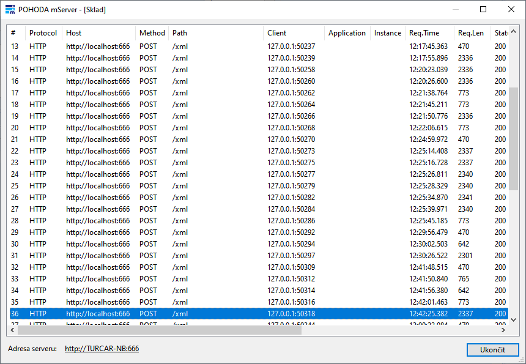

## 3. Import dat do programu Sklad

V aplikaci postupně synchronizujte:

1. **StockView / Sync** – skladové položky (založené skladové karty) z POHODY.
2. **SupplierView / Sync** – seznam dodavatelů z POHODY.
3. **StorageView / Sync** – seznam skladů z POHODY.

Data se uloží do lokální databáze `warehouse.db` a použijí se pro skladové operace:

- **Příjemka** – naskladnění zboží.
- **Výdejka** – vyskladnění zboží.

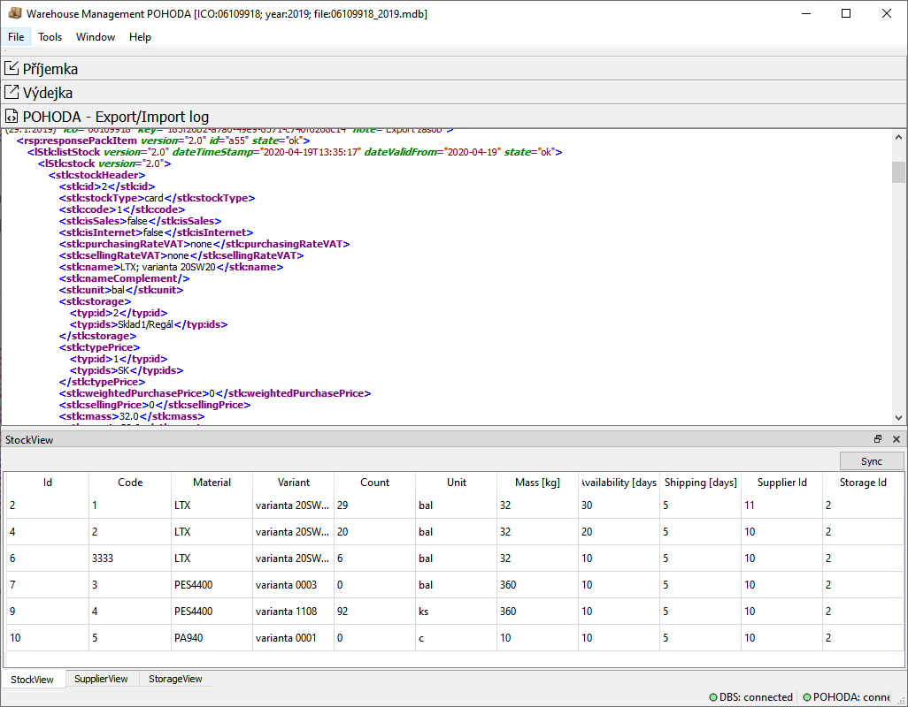

## 4. Příjemka

Příjemka slouží k naskladnění materiálu. Vyplňte datum naskladnění, dodavatele z POHODY, položku (materiál, variantu a měrnou jednotku) z importovaných skladových karet, množství a pozici ve skladu.

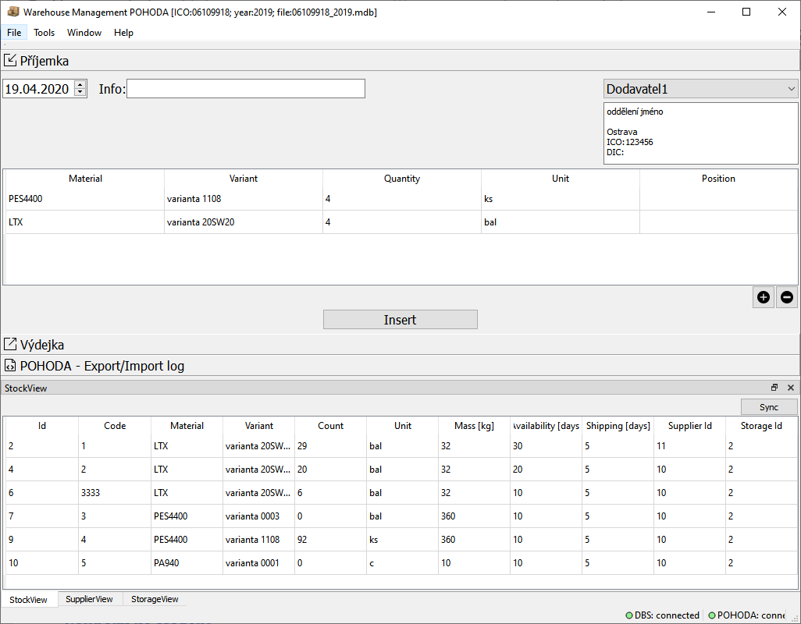
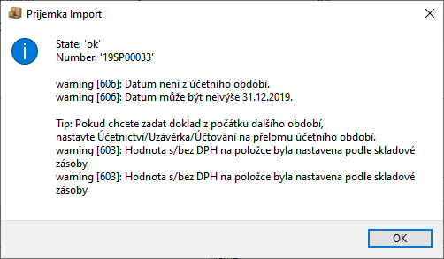

## 5. Výdejka

Výdejka slouží k vyskladnění materiálu. Vyplňte datum vyskladnění, odběratele dostupného z dat POHODY, položku (materiál, variantu a měrnou jednotku) z importovaných skladových karet, množství a pozici ve skladu.

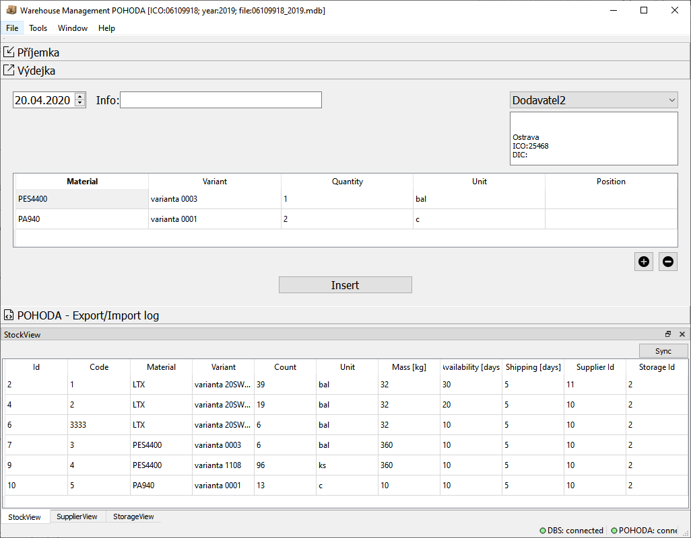
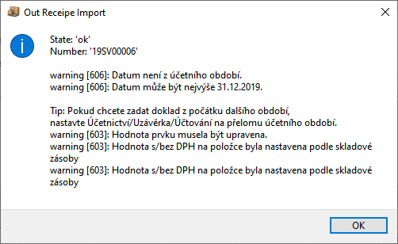

## 6. Skladové pohyby

Každá příjemka a výdejka se zaznamená jako skladový pohyb. Záznam obsahuje číslo dokladu z POHODY a jeho stav (OK nebo chyba), zboží a dodavatele či odběratele, datum a typ pohybu, množství položek a celkový stav skladu po provedení pohybu.

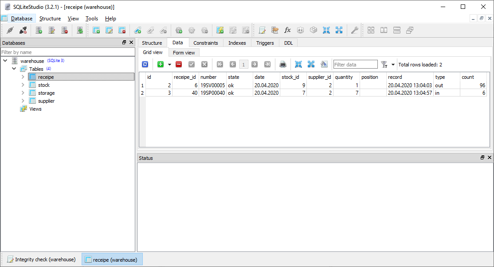

## 7. Skladové pozice

Skladová pozice může mít až čtyři úrovně: sekci, regál, patro a místo v regálu. Při skladových pohybech aplikace kontroluje:

- zda se zboží přijímá na prázdnou pozici nebo na pozici obsazenou stejným materiálem,
- zda výdej probíhá z pozice obsahující daný materiál a požadované množství,
- celkové zatížení regálu.

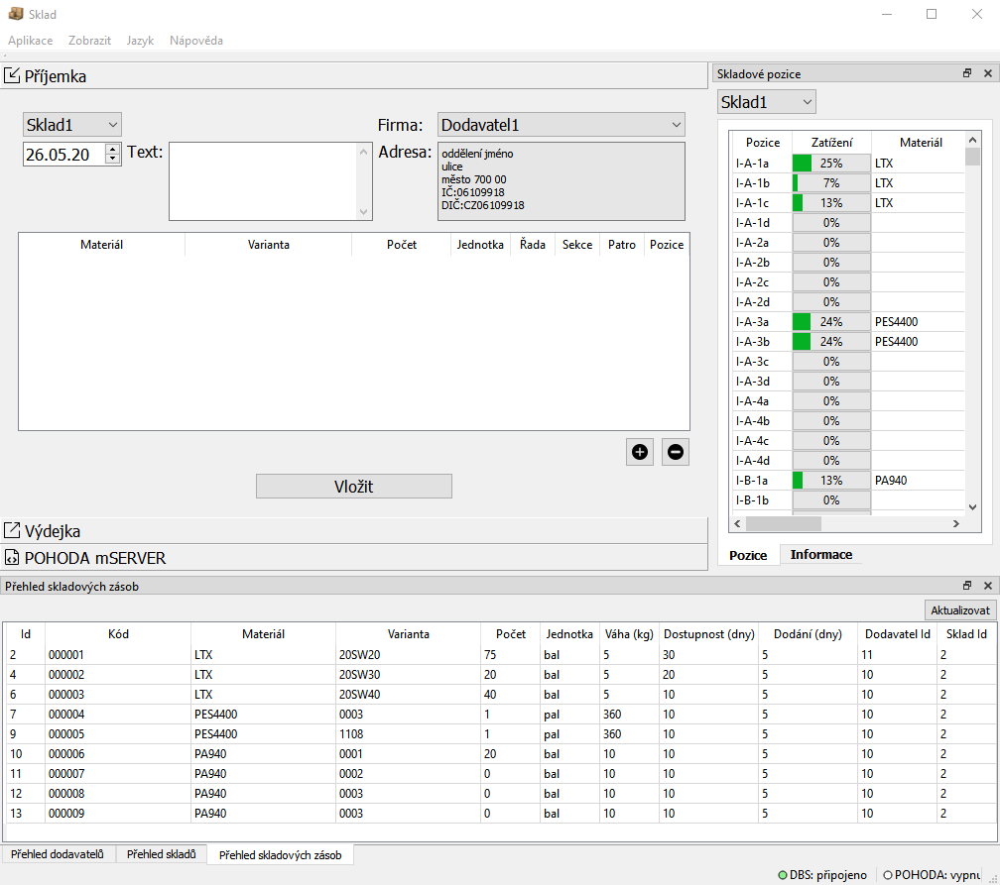
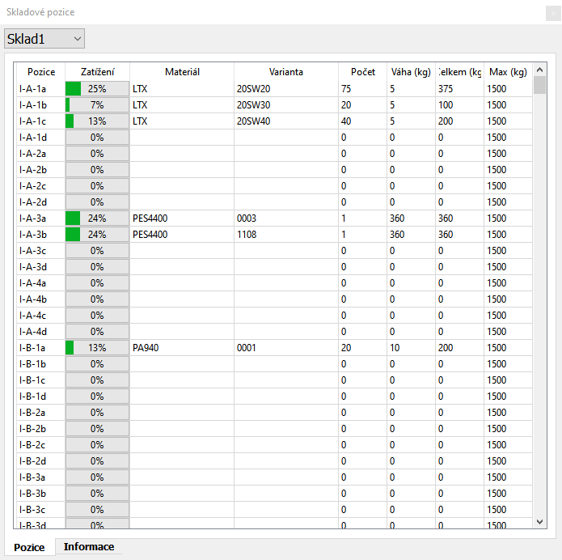

Aplikace podporuje také tmavý režim.

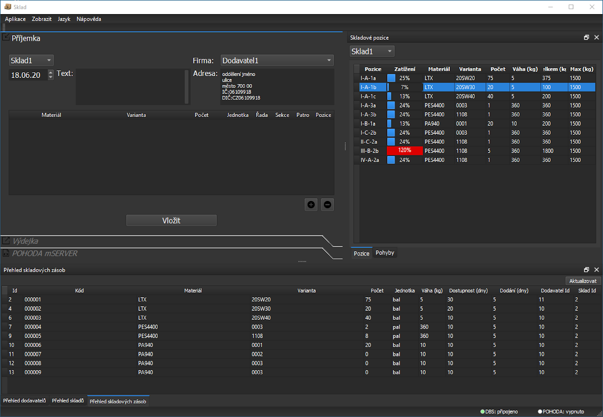

## Soubory ke stažení

- [Zdrojový kód a soubory aplikace](https://github.com/CodElecCz/pohoda-warehouse-management)

Vychází z článku [Ing. Radomíra Turči](https://www.codelec.cz/me-prispevky/sklad-pohoda).
