# Warehouse for the POHODA Accounting System

An example warehouse-management application that extends the POHODA accounting system. It builds on POHODA's stock functions with support for item variants, warehouse locations, and stock-level reporting.

The application supports:

- goods receipts and issues,
- tracking and reporting item variants such as type or color,
- receiving and issuing goods at specific warehouse locations,
- viewing warehouse space usage and current stock levels.

## 1. Configure POHODA

Open the accounting unit in POHODA and select **Database / POHODA mServer**. Create a record with a name, the accounting unit, and port `666`.

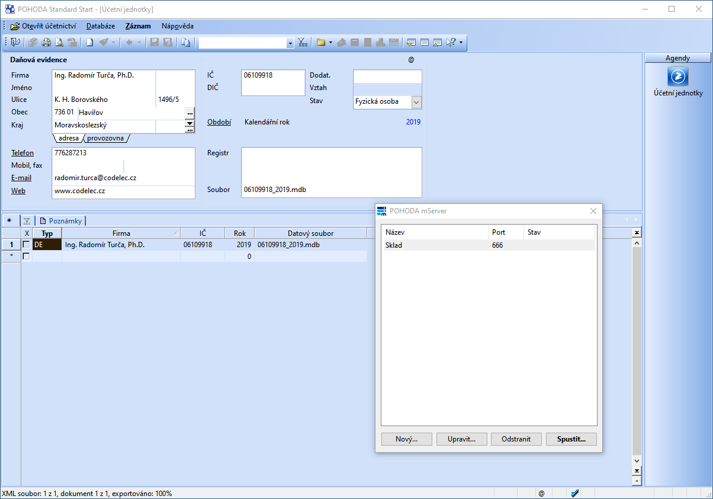
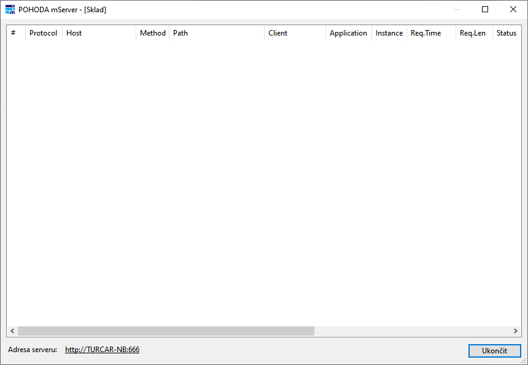

## 2. Configure the warehouse application

In the application directory, edit `warehouse.ini` and set the IČO of the accounting unit configured in POHODA mServer:

```ini
[Pohoda]
AccountingUnitIco="06109918"
```

After startup, the **POHODA - Export/Import log** window shows the accounting units read by the application. The POHODA mServer window shows the incoming HTTP POST request.

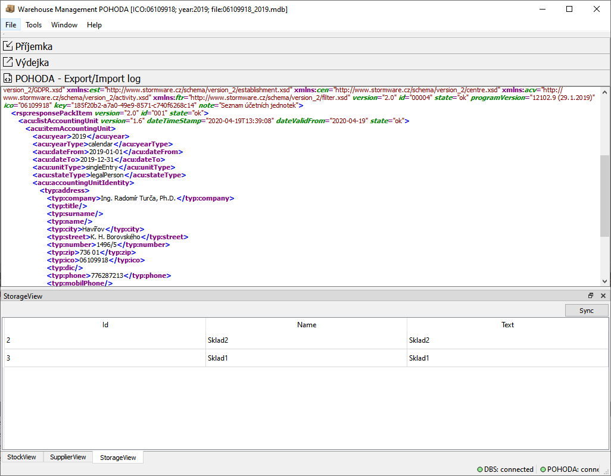
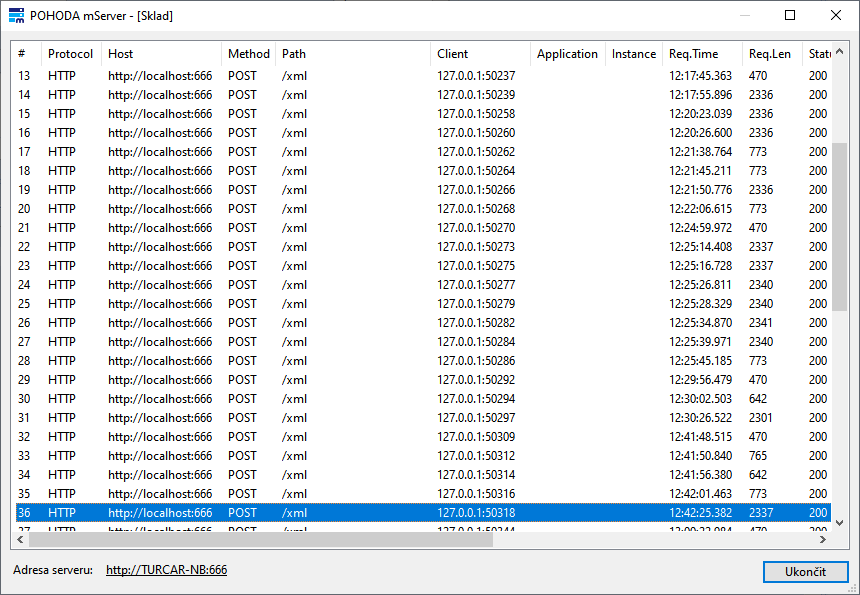

## 3. Import data

Synchronize these records in the application:

1. **StockView / Sync** – stock items (existing stock cards) from POHODA.
2. **SupplierView / Sync** – the supplier list from POHODA.
3. **StorageView / Sync** – the warehouse list from POHODA.

The data is stored in the local `warehouse.db` database and used for warehouse operations:

- **Goods receipt** – putting goods into stock.
- **Goods issue** – taking goods out of stock.

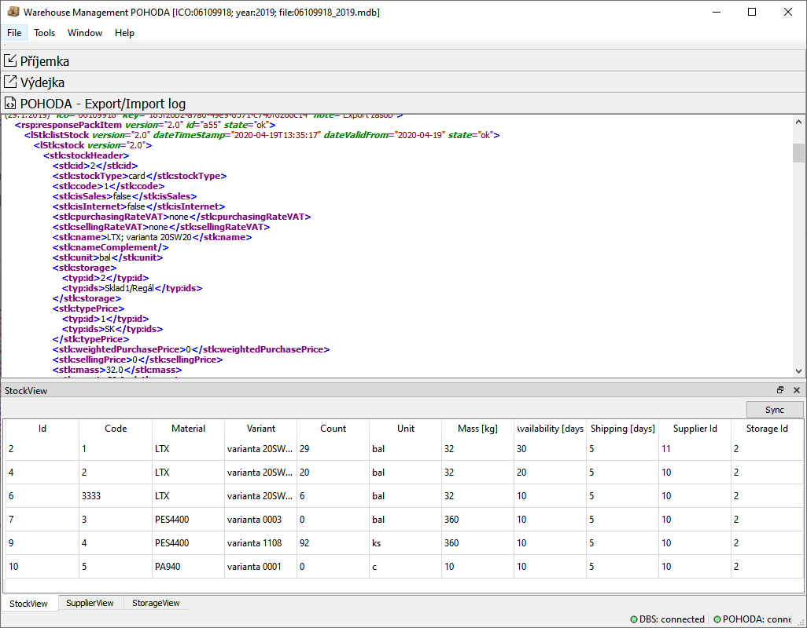

## 4. Goods receipt

A goods receipt records materials put into stock. Enter the receipt date, a supplier from POHODA, the item (material, variant, and unit) from the imported stock cards, and the quantity and warehouse location.

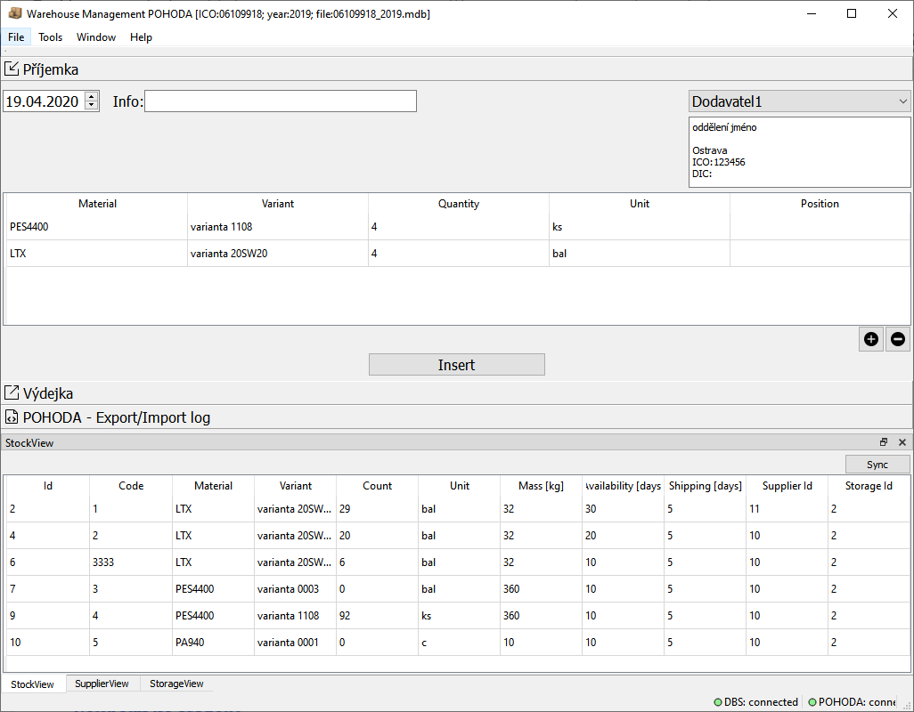
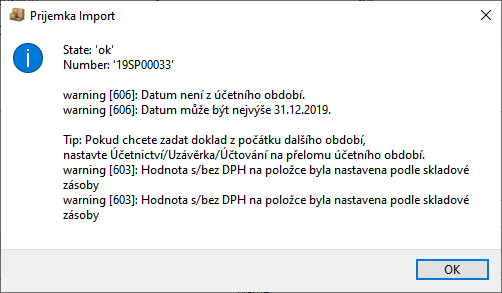

## 5. Goods issue

A goods issue records materials taken out of stock. Enter the issue date, a customer available from POHODA data, the item (material, variant, and unit) from the imported stock cards, and the quantity and warehouse location.

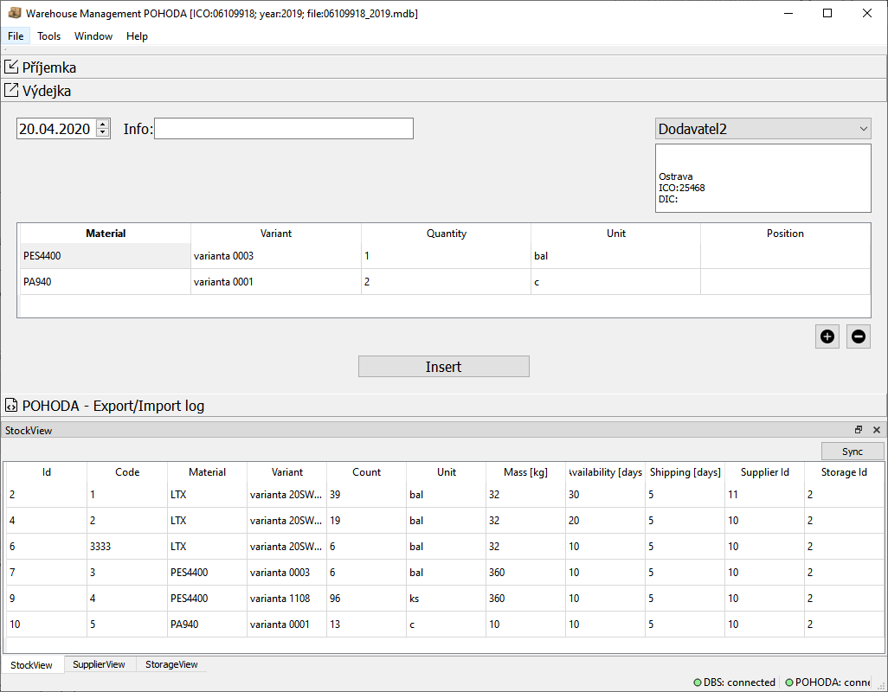
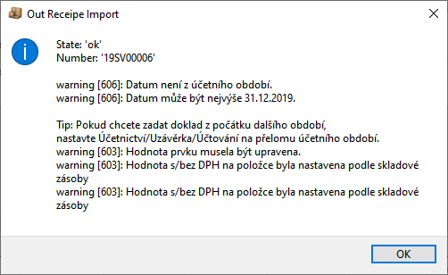

## 6. Stock movements

Each goods receipt and issue is recorded as a stock movement. The record includes the POHODA document number and status (OK or error), the item and supplier or customer, the date and movement type, the quantity moved, and the total stock level after the movement.

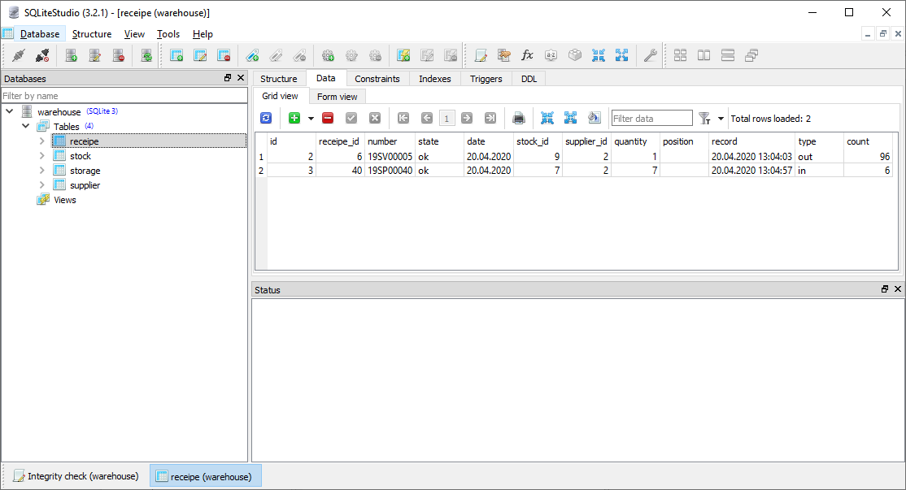

## 7. Warehouse locations

A warehouse location can have up to four levels: section, rack, shelf, and place on the rack. For each movement, the application checks:

- whether goods are received into an empty location or one holding the same material,
- whether an issue is made from a location containing the requested material and quantity,
- the total load on the rack.

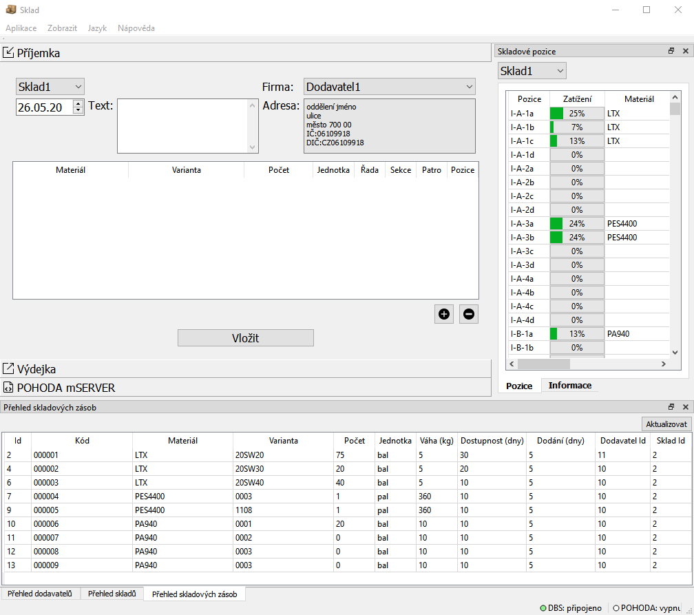
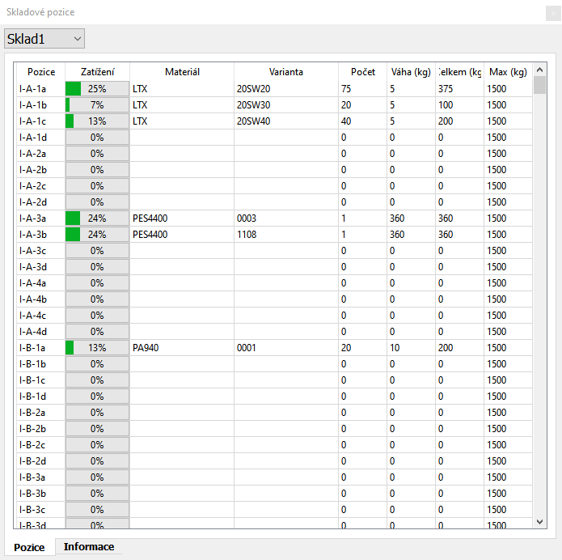

The application also supports dark mode.

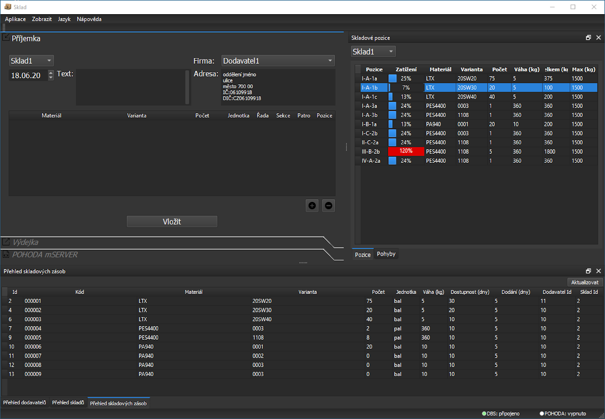

## Downloads

- [Source code and application files](https://github.com/CodElecCz/pohoda-warehouse-management)
